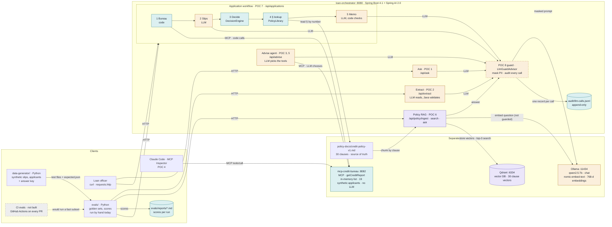
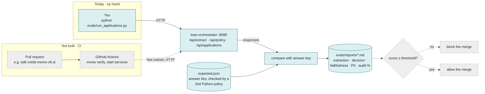
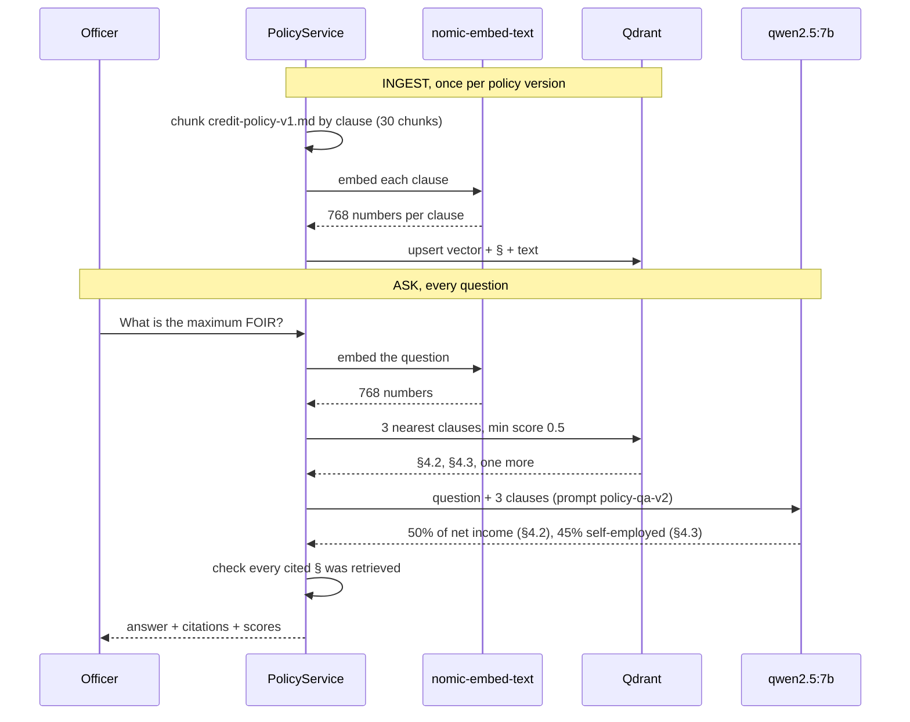
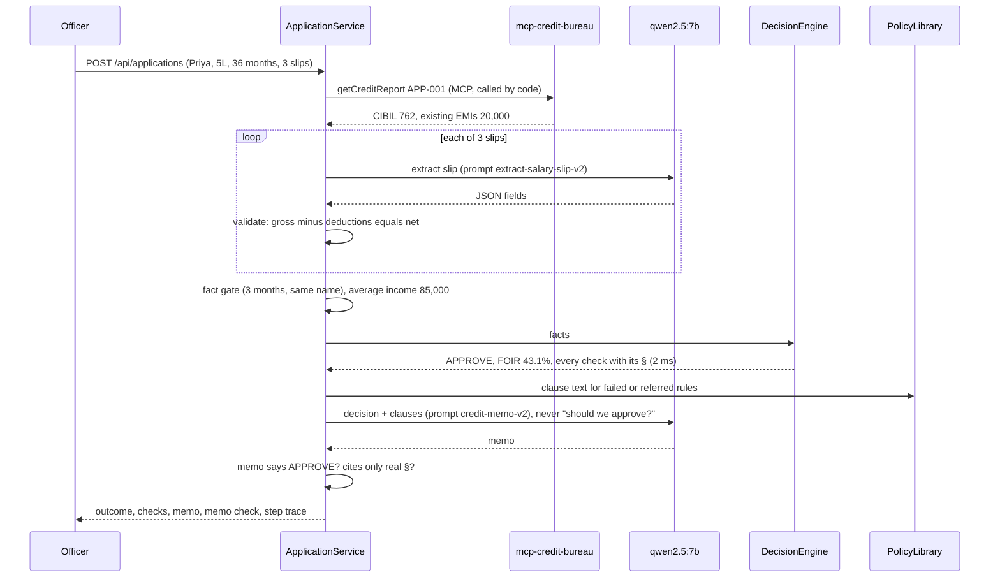

# LoanPilot: Architecture

Two views:
- **As built (POC 1–8):** what runs today, where each kind of AI is used, and why.
- **Target:** the production design the POCs are working towards.

## As built: POC 1–8

### System map

Colours: amber = LLM call, violet = embeddings / vector DB / RAG, teal = plain Java or MCP, dashed amber = the POC 8 guard, dashed grey = not built yet.



How to read it:
- **Every LLM chat call** (Ask, Extract, Advise, the RAG answer, slip reading, memo) goes through the POC 8 guard: PII is masked first, then one audit record is written per call (ADR-0004). Embedding calls don't use `ChatClient`, so they bypass it (a known gap).
- **Only Policy RAG** uses embeddings and the **vector database**. Nothing else needs to search by meaning.
- **The bureau is reached two ways over MCP:** the Advise agent calls it because the LLM chose to; the workflow calls it because the code always does. Claude Code uses the same tool directly (POC 4).
- **The workflow does not use RAG.** It already knows the rule is §4.2, so it reads §4.2 from the file (lookup, not search).
- **Evals are outside clients.** Python scripts call the running app over HTTP, like Postman would. Nothing in the Java code calls them. Today you run them by hand; CI evals (dashed grey) aren't built.
- **There is no database.** No H2, no Postgres. See "Where data lives today" below.

### Where data lives today (no database)

| Data | Today | Target |
|---|---|---|
| Bureau reports | In-memory `List` in `BureauRepository` (19 synthetic applicants) | Real bureau API behind the same MCP tool |
| Policy vectors | Qdrant (a vector DB, not a relational DB) | Qdrant, or pgvector on Postgres |
| LLM audit log | `audit/llm-calls.jsonl`, append-only, git-ignored | `audit_log` table with retention and access control |
| Applications, decisions, memos | Not stored: returned in the API response | `loan_applications`, `decisions`, `credit_memos` tables |
| Eval answer key | `data-generator/out/applicants/expected.json` | Same, versioned with the golden set |

A database is needed once an application has to be remembered between calls: the state machine and officer review in the target design.

### Evals: today vs CI (POC 8)



Same scripts either way. CI only adds the trigger (every pull request) and a pass/fail threshold. The blocker is speed: the full golden set takes about 3 hours on CPU, so CI would run a small `--fast` subset of boundary cases.

### RAG in detail (POC 6)

Two separate moments that share one embedding model, so the numbers are comparable:



Without RAG, the same model said FOIR means "Fixed Operational Interest Rate".

### Application workflow in detail (POC 7)



### Which technique each POC uses

| POC | What | LLM | Embeddings | Vector DB | RAG | MCP | Java decides |
|---|---|---|---|---|---|---|---|
| 1 | Talk to a local LLM | chat | – | – | – | – | – |
| 2 | Read salary slips | extract | – | – | – | – | validation, sums |
| 3 | Tool calling | picks tools | – | – | – | – | EMI maths |
| 4 | MCP server | – | – | – | – | server | – |
| 5 | MCP client | picks tools | – | – | – | client | – |
| 6 | RAG over policy | answer | nomic | Qdrant | yes | – | § check |
| 7 | Decision + workflow | slips, memo | – | – | no (lookup) | client | **the decision** |
| 8 | Guardrails + evals | masked + audited | – | – | – | – | masking, audit, faithfulness check |

### Why each component

| Component | POC | Why we chose it | Trade-off / later |
|---|---|---|---|
| Spring AI 2.0 | 1+ | One Java API for chat, structured output, tools, MCP and vector stores | Swap Ollama for Claude with config, not code |
| Ollama + qwen2.5:7b | 1+ | Runs on the laptop: free, and no data leaves the machine | Slow on CPU (2–4 min per call); GPU or hosted model in production |
| nomic-embed-text | 6 | Small local embedding model, 768 numbers per text | Changing the model means re-embedding every clause |
| Qdrant | 6 | Purpose-built vector DB; Windows binary, no Docker; stores § and text with each vector | pgvector once we move to Postgres |
| MCP (mcp-credit-bureau) | 4, 5, 7 | The bureau owns its data; any AI client uses the same tool through one contract | Needs auth (OAuth) and audit before real use |
| DecisionEngine (plain Java) | 7 | Same answer every time, unit-tested, explainable rule by rule (ADR-0001) | Limits move to a versioned policy config |
| Workflow, not agent | 7 | Every application needs the same facts in the same order (ADR-0003) | New steps need code changes |
| Python (data-generator, evals) | 2+ | Fast scripts outside the product; all data synthetic | Evals run in CI on every prompt change |
| PII guard + audit log (`LlmGuardAdvisor`) | 8 | One advisor on every `ChatClient`: mask before, audit after; can't be forgotten (ADR-0004) | Embeddings not guarded yet; JSONL file becomes a DB table |
| Memo faithfulness check (code) | 8 | Every memo number must come from its input; key figures, disclosures, no overclaim | Can't judge tone or a right number with the wrong label |

### Where AI is deliberately not used
- **Maths** (EMI, FOIR, totals, averages): Java. The LLM once "added" deductions to 19,700 instead of 11,150.
- **The decision**: `DecisionEngine`, 2 ms, 18 unit tests. An LLM's output can't be unit-tested or replayed exactly for an audit.
- **Live data** (credit score, EMIs): MCP tools, never RAG. RAG is for stable documents.
- **Choosing the steps of an application**: a fixed workflow. The agent once invented an applicant name.

## Target architecture

The production design the POCs are working towards. Some of it isn't built yet (core banking and account aggregator MCP servers, officer screen, state machine, database).

### Big picture (target)

```
 Applicant (browser)
      │  apply + upload salary slips, bank statement, KYC
      ▼
┌─────────────────────────────────────────────────────────────┐
│  loan-orchestrator  (Spring Boot, :8080)                    │
│                                                             │
│  Intake Agent → Document Extraction → Data Agent → Policy   │
│   (chat)         (PDFBox + LLM)       (MCP tools)  Agent    │
│                                                    (RAG)    │
│                         │                                   │
│                         ▼                                   │
│        Decision Engine: RULES + SCORECARD (pure Java)       │
│                         │                                   │
│                         ▼                                   │
│        Credit Memo Agent → Credit Officer screen (human)    │
│                                                             │
│  Guardrails: PII masking · audit log · prompt versions      │
└──────┬──────────────┬───────────────┬───────────────┬───────┘
       │ MCP          │ MCP           │ MCP           │
       ▼              ▼               ▼               ▼
 mcp-core-banking  mcp-credit-bureau  mcp-account-   Qdrant :6333
   :8081             :8082            aggregator     credit policy
                                       :8083         vectors
                              │
                   H2 / Postgres  ←  Ollama :11434
```

### Application lifecycle (target state machine)

| Status | What happens | Who | AI? |
|---|---|---|---|
| `SUBMITTED` | Applicant chats; intake agent collects details | Intake Agent | LLM |
| `DOCS_RECEIVED` | PDFs saved to `storage/{appId}/` | Java | – |
| `EXTRACTED` | PDF text → **PII masked** → JSON (salary, employer, month) | Local LLM + validation | LLM |
| `VERIFIED` | Slip salary vs bank credits, name vs KYC | Java rules | **No** |
| `DATA_PULLED` | Bureau score, existing EMIs, transactions via MCP | Data Agent | LLM + MCP |
| `POLICY_CHECKED` | Relevant policy clauses with citations | Policy Agent | RAG |
| `DECIDED` | EMI, FOIR, limits, scorecard → recommendation | Decision Engine | **No** |
| `MEMO_READY` | Credit memo explaining the decision, with sources | Memo Agent | LLM |
| `OFFICER_REVIEW` | Human reviews & approves/rejects | Credit officer | – |
| `APPROVED` / `REJECTED` | Notify, audit trail complete | Java | – |

Locally there is **no Kafka**: a DB-backed state machine plus Spring events. See ADR-0002.

### Worked example

Priya, salaried, ₹85,000/month net, existing EMI ₹20,000, wants ₹5,00,000 for 36 months at 12%.

- New EMI = P·r·(1+r)^n / ((1+r)^n − 1), r = 0.01, n = 36 → **₹16,607**
- FOIR = (20,000 + 16,607) / 85,000 = **43.1%** ≤ 50% ✅
- CIBIL 762 ≥ 700 ✅ · Max loan 20 × 85,000 = 17L ≥ 5L ✅ · Bounces 0 ✅
- → **RECOMMEND APPROVE**, memo cites policy §4.2, §4.5, §4.7

### Data model (target)

```
customers(id, name, pan_masked, dob, employment_type, employer)
existing_loans(id, customer_id, type, emi, outstanding)
bureau_reports(pan_hash, score, active_accounts, dpd_90, enquiries_6m)
bank_transactions(id, account_id, date, amount, type, narration)
loan_applications(id, customer_id, amount, tenure, purpose, status, created_at)
documents(id, application_id, type, file_path, uploaded_at)
extracted_facts(id, application_id, doc_id, field, value, confidence)
decisions(id, application_id, outcome, score, foir, reason_codes_json)
credit_memos(id, application_id, content, model, prompt_version)
audit_log(id, application_id, step, actor, model, prompt_version, input_hash, output, ts)
```
