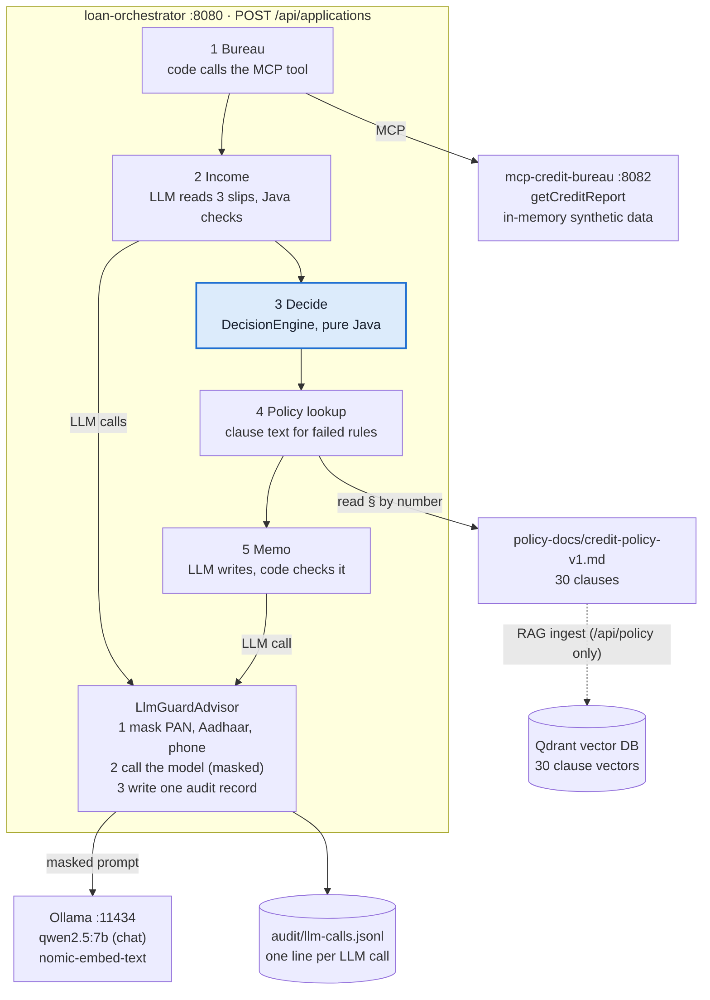
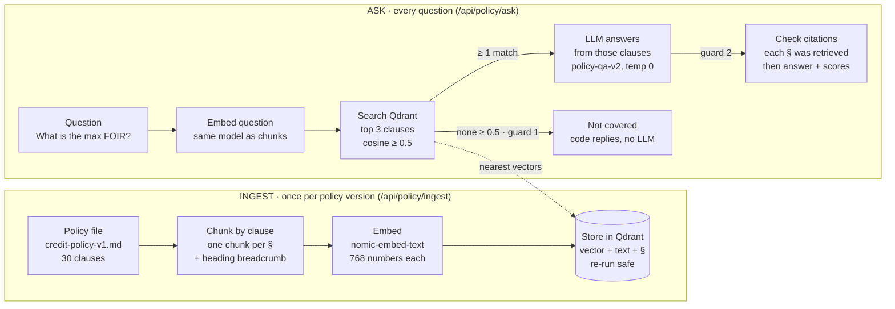
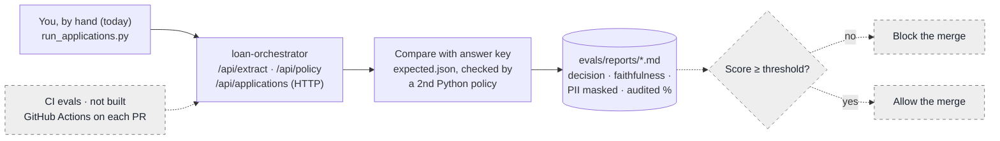

# LoanPilot: Problem, Architecture & Concepts (POC 1–8)

Oct 19, 2026 · kampillichiru

A plain-language guide to what LoanPilot is, how it fits together, and why each AI concept is used. For the detailed system map and ADRs, see [architecture.md](architecture.md).

## 1. Problem statement

LoanPilot uses AI to speed up the slow, manual parts of a personal-loan check, while the yes/no credit decision stays in plain, tested Java.

**What underwriting is.** Before a bank lends money, a credit officer checks whether the person can repay. For a salaried applicant like our synthetic "Priya" (₹5,00,000 for 36 months), that means:

1. Read 3 months of salary slips and work out net income.
2. Pull the credit bureau report (CIBIL score, existing EMIs, recent enquiries).
3. Compute the new EMI and the FOIR, the share of income already going to EMIs.
4. Check each number against the bank's credit policy (for example, FOIR ≤ 50%, CIBIL ≥ 700).
5. Write a credit memo that explains the decision, citing policy sections.

**Why it is slow.** Steps 1 and 5 are reading and writing. Steps 2 and 4 mean jumping between systems and a long policy document. Only step 3 is maths.

**What LoanPilot does.** It splits the work by what each tool is good at:

| Work | Who does it | Why |
| --- | --- | --- |
| Read messy documents (salary slips) | LLM, then Java validates | Language is what LLMs are good at |
| Fetch live data (bureau report) | MCP tool, called by code | Data must be current and exact |
| Look up policy rules | RAG over the policy document | Find the right clause by meaning, with a citation |
| EMI, FOIR, approve/reject | Plain Java `DecisionEngine` | Must be exact, repeatable, unit-tested and auditable |
| Write the credit memo | LLM, checked by code | Explaining is a language task; code verifies every number |

**What it deliberately does not do.** The LLM never decides, never does maths, and never sees raw PAN, Aadhaar, account numbers, phones or emails. Every LLM call is logged. All data is synthetic.

In one sentence: **the LLM explains, code decides.**

## 2. Architecture

LoanPilot is 2 Spring Boot apps plus 2 local programs: `loan-orchestrator` (the main app), `mcp-credit-bureau` (a mock bureau over MCP), Ollama (runs the LLMs) and Qdrant (vector DB for policy search). The picture follows one loan application.



Read it top to bottom. Steps 1, 3 and 4 are plain code. Steps 2 and 5 are the only LLM calls, and both go through `LlmGuardAdvisor` before reaching Ollama. Qdrant serves the separate policy Q&A endpoint (POC 6); the workflow reads clauses by number instead.

The other endpoints reuse the same parts: `/api/ask` (POC 1) and `/api/extract` (POC 2) call Ollama through the guard, and `/api/advise` (POC 3, 5) lets the LLM choose which bureau tool to call.

## 3. Concepts used, POC by POC

Each POC adds one AI idea on top of the last. For each one: what it is, a tiny example, and why LoanPilot needs it.

### POC 1: Prompts and a local LLM

- **What:** An LLM is a text predictor. You send a *system prompt* (standing instructions: "you are a banking assistant") and a *user prompt* (the question). *Temperature* controls randomness: 0.0 picks the likeliest word every time, 1.2 takes more chances.
- **Example:** Ask "what is FOIR?" twice at temperature 1.2 and you get two different wordings. Remove the system prompt and it happily answers off-topic questions.
- **Why:** Ollama runs `qwen2.5:7b` on the laptop, so no data leaves the machine and calls cost nothing. Prompts live in versioned files (`banking-assistant-v1.st`) so every audit record can name the exact prompt used.

### POC 2: Structured extraction

- **What:** Ask the LLM to return JSON that fits a Java record, then let Spring AI turn it into an object: `.entity(SalarySlip.class)`.
- **Example:** Free text "Basic 50,000 … Net Pay 85,000" becomes `SalarySlip(employer, month, gross, deductions, net)`.
- **Why:** Code can't use prose. Java then validates the result (gross minus deductions must equal net), because the model once "added" deductions to 19,700 instead of 11,150. **The LLM reads, Java checks.**

### POC 3: Tool calling (the agent loop)

- **What:** You describe Java methods to the model (`@Tool calculateEmi`, `@Tool getCibilScore`). The model can't run them, but it can reply "please call `calculateEmi(500000, 12, 36)`". Spring AI runs the method and sends the result back. The model then writes the answer.
- **Example:** "Can Priya afford 5L for 3 years?" leads to two tool calls, then an answer built from their results.
- **Why:** The model is bad at maths and doesn't know live data. Tools give it both, computed by code.

### POC 4: MCP server

- **What:** MCP (Model Context Protocol) is a standard way to publish tools over HTTP, a bit like OpenAPI for AI tools. Any MCP client (Claude Code, MCP Inspector, our orchestrator) can discover and call them.
- **Example:** `mcp-credit-bureau` on port 8082 exposes `getCreditReport(applicantId)`.
- **Why:** The bureau team owns its data and contract. AI apps don't link its code; they call it, the same way microservices call each other.

### POC 5: MCP client

- **What:** The orchestrator stops using local `@Tool` methods and discovers the bureau's tools over MCP at startup.
- **Why:** It decouples the AI app from the services. Add a tool to the server and every client sees it, with no redeploy of the client.

### POC 6: RAG over the credit policy

- **What:** RAG (Retrieval-Augmented Generation) means finding the relevant document text first, then giving it to the LLM to answer from. *Embeddings* turn text into 768 numbers so that texts with similar meaning have similar numbers. A *vector DB* (Qdrant) finds the nearest ones quickly.
- **Example:** "What is the max FOIR?" retrieves §4.2 and §4.3, and the answer cites them. Without RAG, the model said FOIR means "Fixed Operational Interest Rate".
- **Why chunk by clause:** one clause is one rule, so each citation points to a single §. Code then checks that every cited § was actually retrieved.
- **Rule:** RAG is for stable documents only. Live data (scores, EMIs) comes from tools.

### POC 7: Decision engine and workflow

- **What:** A pure-Java `DecisionEngine` runs the rules (EMI, FOIR, CIBIL, max loan) in about 2 ms with 18 unit tests. A fixed workflow, not a free agent, runs the steps in order: bureau, slips, decide, policy lookup, memo.
- **Why a workflow and not an agent:** Every application needs the same facts in the same order. When the agent chose its own steps, it once invented an applicant name.
- **Why lookup and not RAG here:** The engine already knows the failed rule is §4.2, so it reads §4.2 directly. Search is for when you don't know where the answer is.

### POC 8: Guardrails and evals

- **What:** A *guardrail* is code that wraps every LLM call: mask PII before, write an audit record after. An *eval* is an exam with a known answer key that scores the system.
- **Example:** `ABCDE1234F` reaches the model as `[PAN]`. The golden set of 20 boundary applicants (FOIR exactly 50% vs 50.002%) scored 21/21 on decisions.
- **Why:** It enforces rules 2 and 3 in one place (`LlmGuardAdvisor`), so new services get them for free. A memo faithfulness check in code confirms every number in the memo came from the input.

## 4. RAG in depth

RAG makes the model answer from our policy text instead of from memory. Without it, `qwen2.5:7b` says FOIR means "Fixed Operational Interest Rate, 9% to 14%". With it, the answer is 50% (§4.2) and 45% for self-employed (§4.3), with citations. It runs in two phases at different times.



The top row runs once per policy version; the bottom row runs for every question. Both use the same embedding model, so their numbers are comparable.

### Ingest: once per policy version

Code: `PolicyIngestService.ingest()`.

1. **Chunk by clause.** `PolicyChunker` splits the markdown on `### §4.2 ...` headings, one chunk per clause, and puts a breadcrumb line on top of each.
2. **Wrap each chunk as a `Document`.** The text is embedded; the metadata (`docId`, `section`, `title`) travels with the vector but is not embedded. The id is a name-based UUID, so the same input always gives the same id.
3. **Delete, then add.** `vectorStore.delete("docId == 'credit-policy-v1'")` removes old chunks, then `vectorStore.add(documents)` embeds each text with `nomic-embed-text` and writes vector, text and metadata to Qdrant.

What one chunk looks like:

```
4. Credit and affordability rules > §4.2 Maximum FOIR for salaried applicants
Total EMIs, including the new loan, must not exceed 50% of net monthly income...
```

The breadcrumb matters because Spring AI embeds only the text. Without the heading in the text, words like "affordability" and "FOIR" can't help the search.

Chunking was the biggest lever, measured on 16 questions:

| Chunking | Chunks | hit@1 | hit@3 |
| --- | --- | --- | --- |
| Clause (one § per chunk) | 30 | 77% | 100% |
| Fixed 500 characters | 13 | 77% | 92%, each chunk mixed 3–4 clauses |
| Fixed 200 characters | 32 | 69% | 92% |

### What an embedding is

An embedding is 768 numbers that represent what a text means. Texts with similar meaning point in similar directions, and Qdrant compares directions with cosine similarity (1.0 = same, 0 = unrelated). Java analogy: like `hashCode()`, but similar inputs give nearby outputs instead of random ones.

That is how "how much salary can go towards EMIs?" finds the FOIR clause with almost no shared words (3rd place, score 0.557). Questions and chunks must use the same embedding model; changing the model means re-embedding every chunk.

### Ask: every question

Code: `PolicyService.ask()`.

1. **Retrieve.** `vectorStore.similaritySearch()` with `topK(3)`, `similarityThreshold(0.5)` and a `docId` filter. About 0.1 s; `/api/policy/search` runs only this step, for tuning.
2. **Guard 1: refuse before the LLM.** If no clause scores ≥ 0.5, code answers "not covered". The model is never asked, so it can't improvise.
3. **Build the prompt.** Each clause goes in the user message with its label, then the question:

```
Policy clauses:

[§4.2]
4. Credit and affordability rules > §4.2 Maximum FOIR for salaried applicants
Total EMIs ... must not exceed 50% ...

[§4.3]
... self-employed ... 45% ...

Question: What is the maximum FOIR?
```

4. **Call the LLM.** The system prompt `policy-qa-v2.st` says: answer only from the clauses, cite every rule as §x.y, cite the clause that sets the rule (not a definition), say "not covered" if they don't answer it, quote numbers exactly, never approve or reject. Temperature 0.0 with a fixed seed, through `LlmGuardAdvisor`.
5. **Guard 2: check citations.** `Citations.find()` pulls every § from the answer; any § that was not retrieved marks the answer `UNSUPPORTED_CITATION`. The response returns the answer, citations, check result, and each retrieved § with its score.

### Why retrieval is written by hand

Spring AI's `QuestionAnswerAdvisor` does retrieval inside the `ChatClient` call in one line. Doing it explicitly gives three things the one-liner hides: retrieved clauses and scores come back for audit (rule 3), code can refuse before calling the LLM (guard 1), and code can check citations against what was retrieved (guard 2).

### What the experiments taught

| Finding | What it means |
| --- | --- |
| Correct clauses scored 0.70–0.83; "cryptocurrency" still scored 0.58 | Scores are squashed together. A threshold stops nonsense but can't decide scope; the prompt has to |
| The right clause came 3rd for three questions, and the model still used it | `top-k > 1` matters: the LLM re-ranks what retrieval gives it |
| "Is a bounced EMI a problem?" cited §2.4 (the definition), not §4.8 (the rule) | Guard 2 passed it because §2.4 was retrieved. A guard checks that a citation exists, not that it supports the sentence. Prompt v2 fixed it |
| nomic's `search_query:` prefixes fixed one paraphrase but cut the §4.2 vs §4.3 margin to 0.001 | Every change is a trade-off to measure with the eval, not a default |
| "What is Priya's CIBIL score?" is answered as not in the policy | Rule 4 holds: live data comes from MCP, never RAG |

### RAG, lookup or MCP?

| You need | Use | LoanPilot example |
| --- | --- | --- |
| Text found by meaning, location unknown | RAG | An officer's free-form policy question |
| Text whose location you already know | Lookup | Workflow knows the failed rule is §4.2, so `PolicyLibrary` reads §4.2 |
| Live, changing data | MCP tool | CIBIL score, existing EMIs |

That is why the POC 7 workflow doesn't use RAG: searching for something you can address directly only adds a chance of retrieving the wrong clause.

### Gaps before production

- Version the index: store policy version and effective date, filter by the version in force on the application date.
- Hybrid search (keyword + vector), so exact terms like "§4.8" or "FOIR" can't be outranked.
- A citation-support check: does the cited clause actually contain the claimed number?
- Mask and audit embedding calls; they bypass `ChatClient` and the guard today.

## 5. Code walkthrough: one application, start to finish

One call, `POST /api/applications`, takes Priya from application to credit memo. The whole flow lives in `ApplicationService.run()`, about 120 lines, in 5 numbered steps. Paths below are under `loan-orchestrator/src/main/java/com/loanpilot/orchestrator/`.

### Step 0: The request comes in

`application/ApplicationController` receives `LoanApplicationRequest` (applicant id, amount, tenure, employment type, 3 salary-slip texts). Bean Validation rejects bad input with field-level 400s before any AI runs.

### Step 1: Bureau (code calls MCP)

```java
BureauReport report = bureau.creditReport(request.applicantId(), id);
```

`application/BureauClient` calls the `getCreditReport` tool on `mcp-credit-bureau` over MCP. **Code** makes this call every time; the LLM doesn't choose it. On the server, `CreditBureauTools` exposes the tool and `BureauRepository` holds 19 synthetic applicants in an in-memory `List`.

### Step 2: Income (LLM reads, Java checks)

```java
ExtractResponse r = extractService.extract(new ExtractRequest(slipText, null));
```

`extract/ExtractService` sends each slip to the LLM with prompt `extract-salary-slip-v2.st` and gets back a `SalarySlip` record. Java then checks the slip's arithmetic, that there are 3 months, and that the name is the same on all three. If anything fails, the workflow **stops and refers the case**, and code writes that memo. No decision is ever made on unverified facts.

### Step 3: Decide (pure Java, no AI)

```java
Decision decision = engine.decide(facts);
```

`decision/DecisionEngine` produces one `RuleCheck` per policy rule, each with its § number: CIBIL ≥ 700 (§4.5), FOIR ≤ 50% (§4.2), max loan (§4.7), enquiries (§4.6) and so on. Rules with no data source yet (age, bounces) are marked `NOT_CHECKED` so nobody mistakes "not checked" for "passed". The outcome is simple: any FAIL means REJECT, any REFER means REFER, otherwise APPROVE. `EmiCalculator` does the EMI maths and `PolicyLimits` holds the thresholds.

### Step 4: Policy lookup (lookup, not search)

```java
explain.stream().map(policy::clause)
```

`policy/PolicyLibrary` reads clause text **by section number** for only the failed or referred rules, plus §1.3 ("the officer decides"). Sending all 13 clauses cost about 1,800 tokens and led the model to paraphrase them wrongly.

### Step 5: Memo (LLM writes, code checks)

```java
chatClient.prompt().system(memoPrompt).user(input)
    .advisors(a -> a.param(PURPOSE, "credit-memo").param(PROMPT_VERSION, memoPromptVersion))
    .call();
```

The model gets the decision, facts and clauses (prompt `credit-memo-v5.st`) and is never asked "should we approve?". The memo's opening sentence is picked by code (`summaryOpening()`); the model only copies it. Then `application/MemoFaithfulness` checks that every number is in the input, the memo agrees with the engine, and every cited § is real.

### Around every LLM call: the guard

This is the part you never see in the services, by design:

| Class | Job |
| --- | --- |
| `guard/GuardConfig` | A `ChatClientCustomizer` that adds the guard to **every** `ChatClient` Spring hands out |
| `guard/LlmGuardAdvisor` | Runs first in the chain: masks user messages, calls the model, writes one audit record (also on failure) |
| `privacy/PiiMasker` | Regexes for PAN, Aadhaar, account numbers, phones and emails; returns masked text and counts |
| `audit/JsonlAuditLog` | Appends one JSON line per call to `audit/llm-calls.jsonl`: model, prompt version, SHA-256 of the masked input, output, tokens, latency |

### The other endpoints

| Endpoint | Package | POC |
| --- | --- | --- |
| `/api/ask` | `ask/` | 1 |
| `/api/extract` | `extract/` | 2 |
| `/api/advise` (agent picks tools over MCP) | `advise/` | 3, 5 |
| `/api/policy/ingest`, `/search`, `/ask` | `policy/` (`PolicyChunker`, `QdrantVectorCollection`) | 6 |
| `/api/applications` | `application/`, `decision/` | 7, 8 |

## 6. FAQ

### Did we use Postgres?

No, and we didn't use H2 either. There is no database in the project today: neither `pom.xml` has a JDBC, JPA, H2 or Postgres dependency. Each kind of data lives somewhere simpler for now:

| Data | Where it lives today | Later (target design) |
| --- | --- | --- |
| Bureau reports | In-memory `List` in `BureauRepository` (19 synthetic applicants) | Real bureau API behind the same MCP tool |
| Policy vectors | Qdrant (a vector DB, not a relational DB) | Qdrant, or pgvector once on Postgres |
| Audit log | `audit/llm-calls.jsonl`, one JSON line per LLM call | `audit_log` table with retention and access control |
| Applications and decisions | Not stored: returned in the API response | `loan_applications`, `decisions`, `credit_memos` tables |

CLAUDE.md says "H2 for the POC (Postgres later)". No POC has needed it yet, because nothing has to remember an application between calls. A database becomes necessary when we add the application state machine (SUBMITTED → DECIDED → OFFICER_REVIEW) and an officer screen.

### What are CI evals?

**CI** (Continuous Integration) runs checks automatically on every commit or pull request, for example GitHub Actions running `mvnw verify`. **CI evals** means also running the golden set there and blocking the merge if a score drops.

Why it matters for AI: a one-line prompt change can break behaviour without breaking a single unit test. That is exactly what happened with memo v3 and v4, which overclaimed "all criteria met". With CI evals, the change would fail the build:

```
PR: edit credit-memo-v6.st
  -> mvnw verify           (94 unit tests)        PASS
  -> run_applications.py   (golden set)
       decision      21/21  (must be 100%)        PASS
       faithfulness  17/19  (threshold 100%)      FAIL -> merge blocked
```

**Status today:** not built. The evals in `evals/` run by hand on the laptop, and the repo has no CI workflow (`.github/` only holds a `modernize` tool folder). One obstacle is speed: the full run took 2 h 38 min on CPU. A CI version would need a small fast subset (for example 5 boundary cases) or a faster model host.



The top path runs today (dashed = not built yet). CI would call the same endpoints with a fast subset, then use the report's scores to block or allow the merge.

### What else is not built yet?

- Embedding calls are not masked or audited (they bypass `ChatClient`).
- PII masking is regex only; names are not masked.
- No application state, officer screen or human approval step.
- Only one MCP server; core banking and account aggregator are still in the target design.
- No auth on the MCP server.
- Claude API profile (cloud LLM) not added; everything runs on local Ollama.

## 7. Glossary

| Term | Plain meaning |
| --- | --- |
| Advisor (Spring AI) | An interceptor around a `ChatClient` call, like a servlet filter |
| Agent / agent loop | The LLM decides which tool to call next; code runs it and feeds back the result |
| Audit record | One log line per LLM call: model, prompt version, input hash, output |
| CIBIL score | Indian credit score, 300–900; policy needs ≥ 700 |
| Chunking | Splitting a document into pieces before embedding; we split by policy clause |
| CI evals | Running the golden set automatically on every change and blocking bad merges |
| Embedding | 768 numbers that represent a text's meaning; similar meaning gives nearby numbers |
| EMI | Monthly loan instalment |
| Eval / golden set | An exam with a known answer key, used to score the AI system |
| Faithfulness | The memo states only facts that were in its input |
| Fail closed | If a safety step fails, block the result instead of letting it through |
| FOIR | Fixed Obligation to Income Ratio: (existing EMIs + new EMI) ÷ net income; max 50% salaried |
| Guardrail | Code around the LLM that enforces safety (masking, audit, checks) |
| MCP | Model Context Protocol: a standard way to publish tools that any AI client can call |
| PII | Personally identifiable information: PAN, Aadhaar, account number, phone, email |
| Prompt version | A prompt saved as a numbered file (`credit-memo-v5.st`) so changes are traceable |
| RAG | Retrieve the relevant document text first, then let the LLM answer from it |
| Structured output | Asking the LLM for JSON that maps onto a Java record |
| Temperature | Randomness of the model's word choice; 0.0 is most repeatable |
| Tool calling | The LLM asks your code to run a function and uses the result |
| Vector DB | A database that finds the nearest embeddings fast (Qdrant here) |
| Workflow (vs agent) | Code fixes the order of steps; the LLM only does language tasks inside them |
